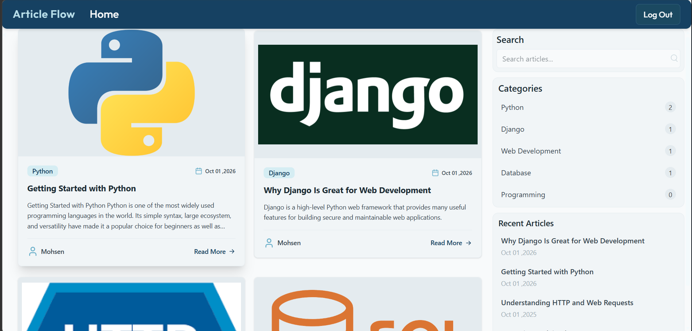
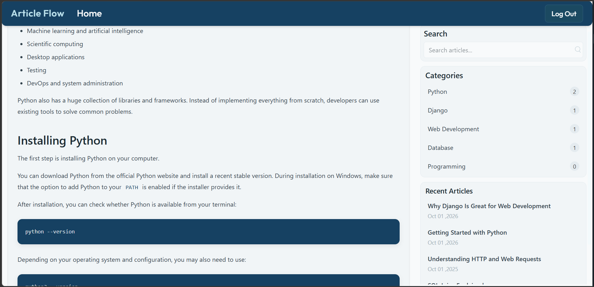
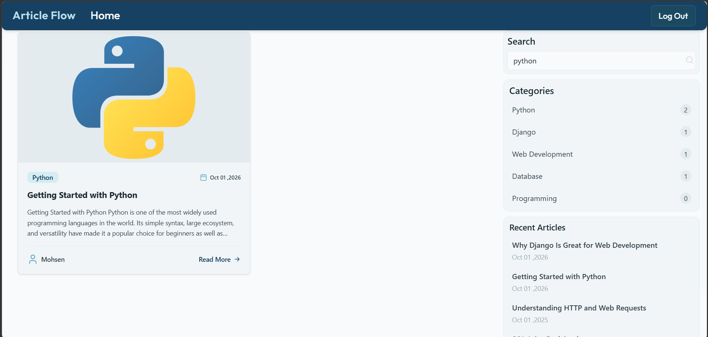
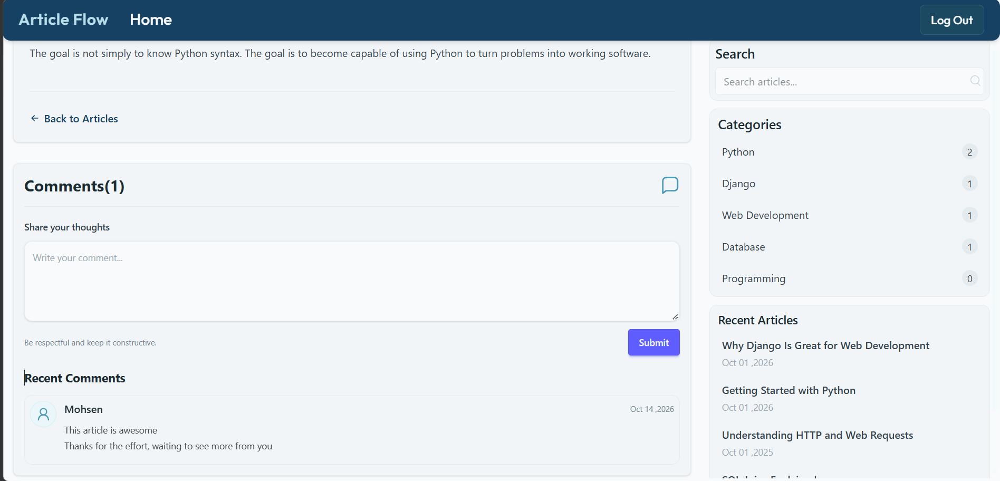
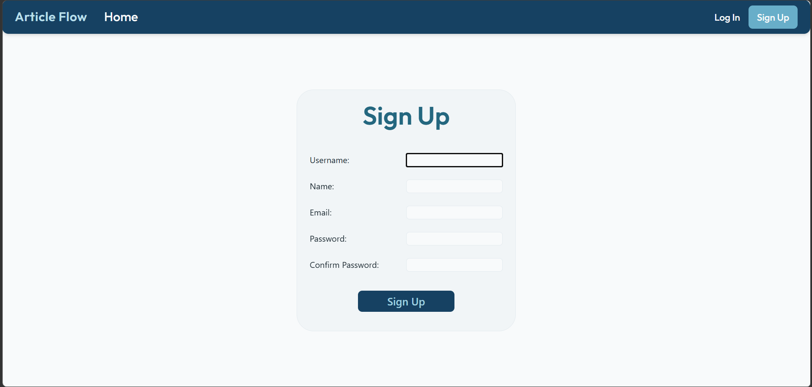

# ArticleFlow

ArticleFlow is a Django-based article management system that allows users to browse articles, explore categories, search for content, and interact through comments.

This project was developed as a learning project to practice Django, database relationships, user authentication, and frontend development with Tailwind CSS.

## Screenshots

### Homepage


### Article Details


### Article Search


### Comments


### Authentication


## Features

- **Article Listing:** Display published articles on the homepage.
- **Article Details:** View the full content and information of each article.
- **Publication Status:** Support for draft and published articles.
- **Category Management:** Organize articles into categories and browse articles by category.
- **User Authentication:** User registration, login, and logout.
- **Comments:** Allow authenticated users to post comments on articles.
- **Article Search:** Search for articles by keyword.
- **Recent Articles:** Display recent articles in the sidebar.
- **Category Sidebar:** Provide quick access to available categories.
- **Access Control:** Restrict article and category management to administrators.
- **Django Admin:** Manage articles, categories, and comments through the built-in administration panel.

## Tech Stack

- **Backend:** Django
- **Language:** Python 3.13.7
- **Frontend:** HTML, Tailwind CSS v4
- **Package Management:** pip, npm
- **Database:** SQLite (development)
- **Version Control:** Git and GitHub

## Project Structure

```text
ArticleFlow/
├── ArticleFlow/
├── blog/
├── users/
├── static/
│   └── css/
│       ├── input.css
│       └── output.css
├── templates/
├── screenshots/
├── .gitignore
├── LICENSE
├── README.md
├── manage.py
├── package.json
├── package-lock.json
└── requirements.txt
```

## Prerequisites

Make sure the following tools are installed:

- Python 3.13.7
- pip
- Node.js and npm
- Git

## Installation and Setup

### 1. Clone the Repository

Using HTTPS:

```bash
git clone https://github.com/Dot006/ArticleFlow.git
cd ArticleFlow
```

### 2. Create a Virtual Environment

```bash
python -m venv .venv
```

Activate the environment on Windows:

```bash
.venv\Scripts\activate
```

On Linux or macOS:

```bash
source .venv/bin/activate
```

### 3. Install Python Dependencies

```bash
pip install -r requirements.txt
```

### 4. Install Frontend Dependencies

```bash
npm install
```

### 5. Compile Tailwind CSS

This project uses Tailwind CSS v4.

```bash
npx @tailwindcss/cli -i ./static/css/input.css -o ./static/css/output.css --watch
```

Keep this command running in a terminal during development so Tailwind can rebuild the CSS when relevant files change.

### 6. Apply Database Migrations

```bash
python manage.py migrate
```

### 7. Create an Administrator Account

```bash
python manage.py createsuperuser
```

### 8. Run the Development Server

In a separate terminal, run:

```bash
python manage.py runserver
```

Open the following address in your browser:

http://127.0.0.1:8000/

## Admin Panel

The Django administration panel is available at:

http://127.0.0.1:8000/admin/

Log in using the administrator account created during setup.

Administrators can create and manage articles and categories through the admin panel.

## Usage

1. Create categories through the Django admin panel.
2. Create articles and assign categories and authors as needed.
3. Set an article's status to `Published` to make it available to readers.
4. Register an account or log in.
5. Browse articles, explore categories, and search for content.
6. Open an article to read its content and view its comments.
7. Submit comments while logged in.

## License

This project is licensed under the terms specified in the [LICENSE](LICENSE) file.
